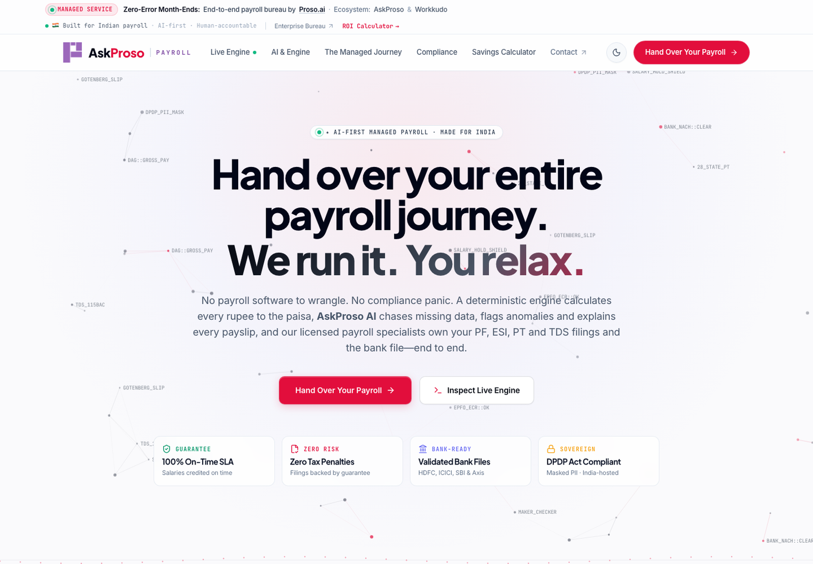
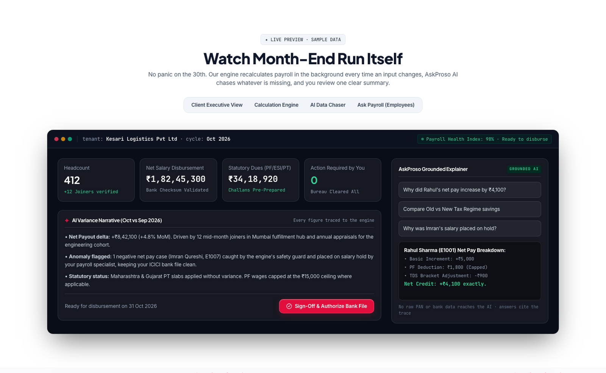
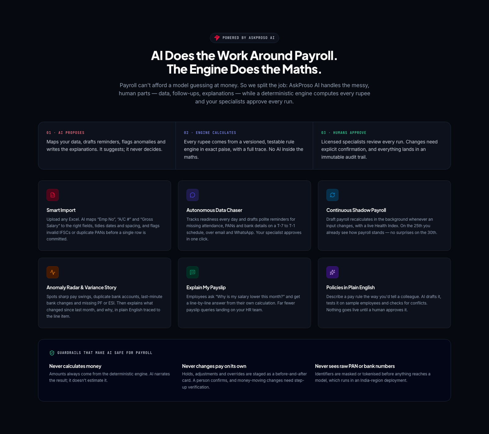
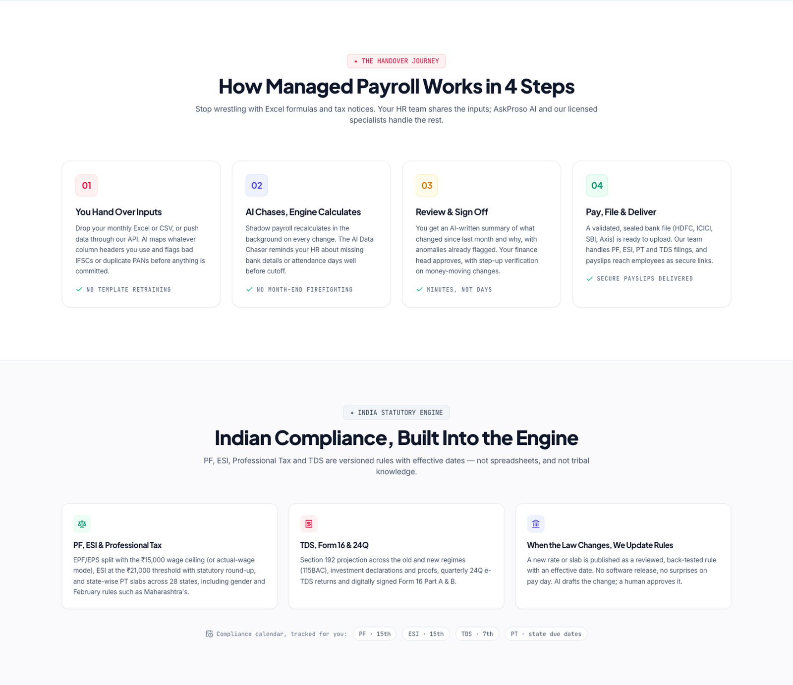
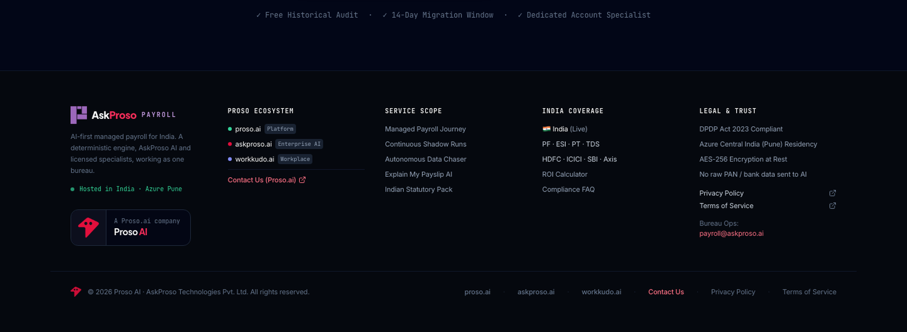
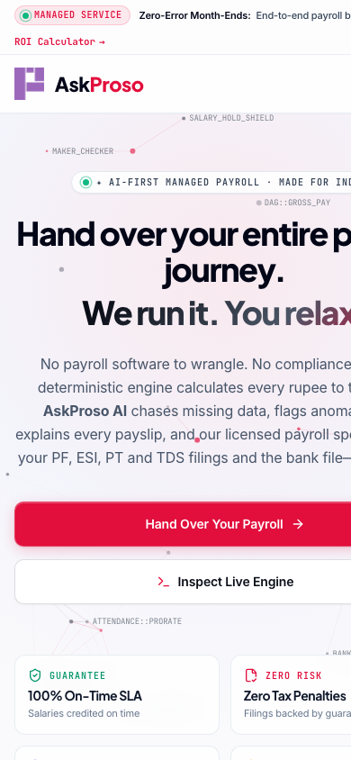

<div align="center">


# Payroll by AskProso

### AI-first managed payroll for India.
**Hand over your entire payroll journey. We run it. You relax.**

[](https://pay.askproso.com)
&nbsp;

&nbsp;


<br />

<a href="https://pay.askproso.com">
  <picture>
    <source media="(prefers-color-scheme: dark)" srcset="screenshots/hero-dark.png" />
    
  </picture>
</a>

**[Visit the live site &rarr; pay.askproso.com](https://pay.askproso.com)**

</div>

---

## What this is

The marketing site for **Payroll by AskProso**: a fully managed payroll service for Indian businesses, powered by [AskProso](https://www.askproso.ai) AI and run by licensed payroll specialists.

Most payroll software hands you a dashboard and wishes you luck on the 30th. We take the whole month-end off your plate: **a deterministic engine calculates every rupee to the paisa, AI does the chasing, flagging and explaining, and a human approves every run.**

This repo is the site itself: a fast, hand-crafted static page with a live interactive product preview. No framework, no tracking, no backend.

## The idea in one line

> **AI proposes. The engine calculates. Humans approve.**

| | Who | Does what |
|---|---|---|
| 🧠 **AI proposes** | AskProso AI | Maps messy Excel files, chases missing data, flags anomalies, writes variance narratives, explains payslips in plain English. |
| ⚙️ **Engine calculates** | Deterministic rule engine | Every rupee in exact paise, from versioned, effective-dated rules, with a full trace. No AI inside the maths. |
| ✅ **Humans approve** | Licensed payroll specialists | Review every run. Changes need explicit confirmation, with step-up verification on money-moving actions and an immutable audit trail. |

The site is built around that story, and it's the reason the AI is safe to trust with payroll.

## What's on the page

<table>
<tr>
<td width="50%" valign="top">

### 🖥️ A product you can poke
An interactive **live engine preview** with four tabs, built on sample data:

- **Client view:** headcount, net disbursement, statutory dues and an AI-written variance narrative
- **Calculation engine:** a step-by-step run with timings
- **AI Data Chaser:** the T-7 → T-1 reminder schedule
- **Ask Payroll:** employee Q&A grounded in the calculation trace

</td>
<td width="50%" valign="top">

### 🤖 AI, with guardrails
A dedicated section on how AI is used *and where it never is*:

- Smart Import, Data Chaser, Shadow Payroll
- Anomaly Radar & variance narrative
- Explain My Payslip
- Policies in plain English
- **Never** calculates money, changes pay on its own, or sees raw PAN / bank numbers

</td>
</tr>
<tr>
<td valign="top">

### 🇮🇳 Indian statutory, built in
PF (EPF/EPS), ESI, state-wise Professional Tax, TDS under Section 192 (old and new regimes), Form 16 and 24Q. Rules are versioned data, so when the law changes, a reviewed rule updates. No release, no pay-day surprises.

</td>
<td valign="top">

### 💸 ROI calculator
Slide team size and current spend to see monthly HR hours saved, cost comparison and annual net savings, formatted in the Indian numbering system (₹1,82,45,300).

</td>
</tr>
</table>

Plus the 4-step handover journey, bank-ready file formats (HDFC, ICICI, SBI, Axis, Yes Bank, generic CSV), a straight-talking FAQ, a consultation modal, and a **one-click light / dark theme** that remembers your choice and follows your OS.

## Screenshots

<p align="center">
  
</p>

<p align="center">
  
</p>

<p align="center">
  
</p>

<p align="center">
  
</p>

<details>
<summary><b>📱 Mobile</b></summary>
<br />
<p align="center"></p>
</details>

## Design language

A technical, precise look, with a bit of life in it.

| Token | Value | Used for |
|---|---|---|
| **Laser Ruby** | `#E20E3C` | The AskProso brand: "Proso", primary actions, highlights |
| **Payroll Purple** | `#9C68BB` | The Payroll product mark and "PAYROLL" label |
| **Electric Indigo** | `#6366F1` | The deterministic engine |
| **Mint Emerald** | `#10B981` | Verified, compliant, on time |
| Type | Plus Jakarta Sans · Inter · JetBrains Mono | Display · body · technical labels |

Ambient details include a 60 fps interactive node-graph canvas in the hero (which pauses when off-screen), animated section dividers, glass surfaces with hairline highlights, and a full dark theme.

## Tech stack

Deliberately small:

- **HTML + [Tailwind CSS](https://tailwindcss.com)** (CDN), with a hand-written design-token layer in `styles.css`
- **Vanilla JavaScript** (ES modules) for the theme, simulator, calculator, FAQ and modal. No framework.
- **[Lucide](https://lucide.dev)** icons
- **[Vite](https://vitejs.dev)** for the dev server and static production build

## Run it locally

You need Node 20+.

```bash
git clone <this-repo-url>
cd paysite
npm install
npm run dev
```

Open <http://localhost:3000>.

```bash
npm run build     # static site in dist/
npm run preview   # serve the production build locally
```

`dist/` is plain static files, so it deploys anywhere: Vercel, Netlify, Cloudflare Pages, S3, or a bare nginx.

> The page loads Tailwind, Lucide and Google Fonts from their CDNs, so it needs an internet connection the first time.

## Project structure

```
paysite/
├── index.html        # The whole page: sections, copy, Tailwind config
├── styles.css        # Design tokens, light/dark themes, buttons, canvas & slider styling
├── app.js            # Theme, hero canvas, live engine simulator, ROI calculator, FAQ, modal
├── img/
│   ├── paylogo.png         # Payroll product mark
│   ├── prosologo.png       # Proso brand mark (full size)
│   └── prosologo-192.png   # Proso brand mark (web size)
├── screenshots/      # Images used in this README
├── vite.config.js
└── package.json
```

## A note on the demo data

Everything in the live preview (Kesari Logistics, the 412 employees, the ₹ amounts, the sample employees) is **fictional sample data** for illustration. No real payroll or personal data is in this repository.

## Part of the Proso family

<p>
  
  &nbsp;<b>Payroll by AskProso</b> is built by <a href="https://www.proso.ai">Proso.ai</a>. See also
  <a href="https://www.askproso.ai">AskProso</a> (enterprise AI) and <a href="https://workkudo.ai">Workkudo</a> (workplace).
  <br />&nbsp;Questions, or want to hand over your payroll? <a href="https://www.proso.ai/contact-us">Get in touch</a> or visit <a href="https://pay.askproso.com">pay.askproso.com</a>.
</p>

<br clear="left" />

---

<sub>&copy; 2026 Proso AI &middot; AskProso Technologies Pvt. Ltd. All rights reserved. The Proso and AskProso names and logos are trademarks of their owners; please don't reuse them without permission.</sub>
